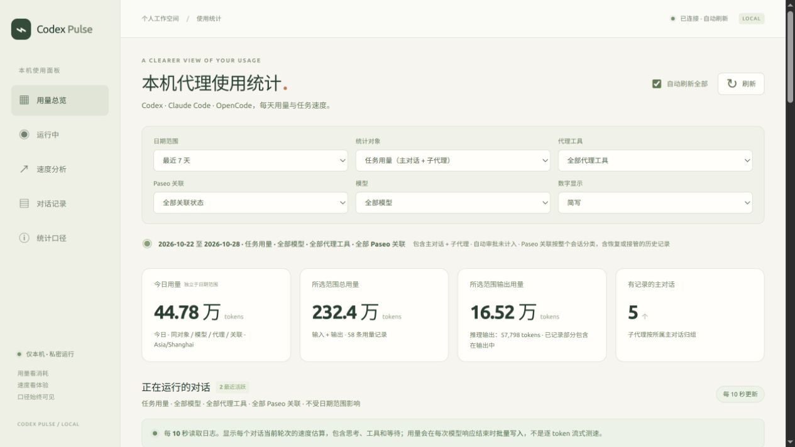
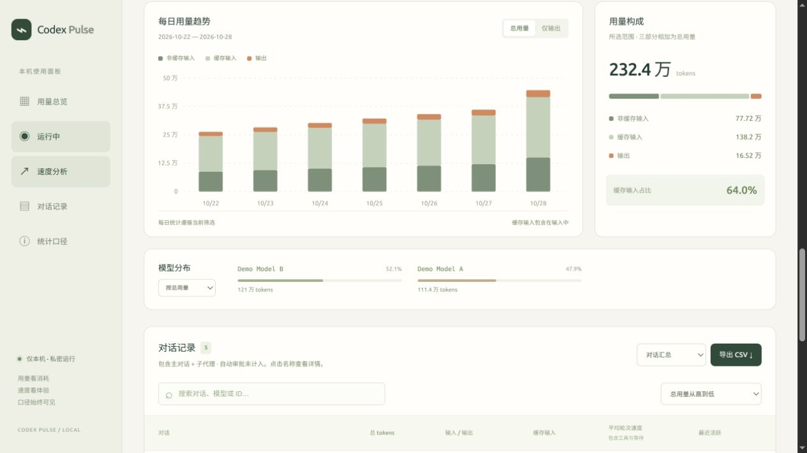
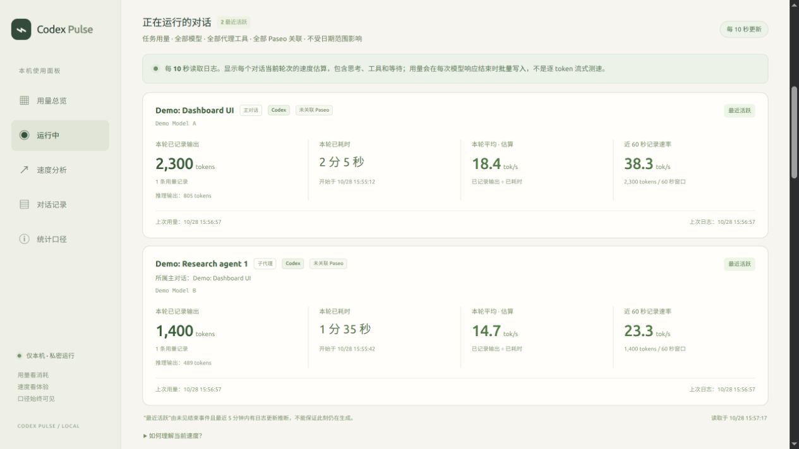
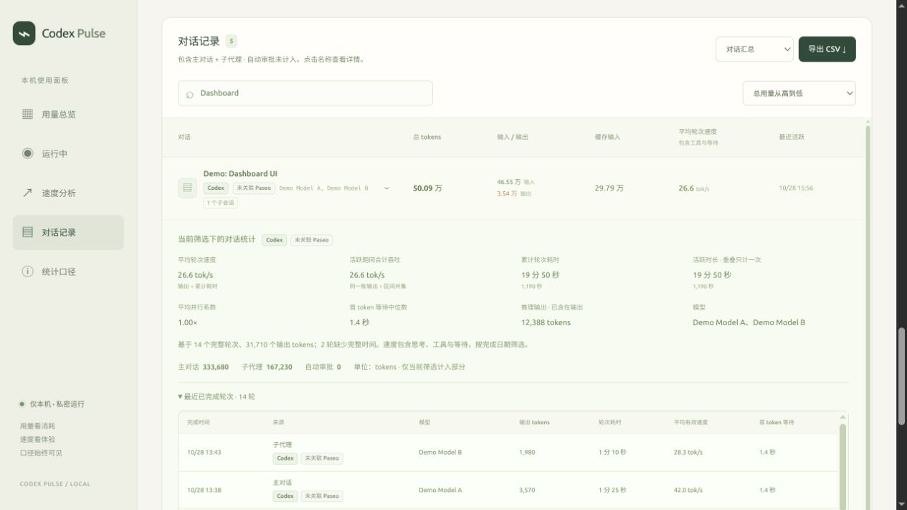

# Codex Pulse

[中文](README.md) | [English](README.en.md)

本机 Codex、Claude Code、OpenCode、Z Code 用量与速度面板，支持 Paseo 会话关联。Local, read-only analytics for agent session logs.

统计每日用量、历史轮次速度、主对话与子代理贡献，以及最近活跃的对话。页面与后端都在当前电脑运行；源码包不包含任何真实对话数据。

## 界面预览

以下截图使用合成数据，数值仅用于展示，并非真实使用记录或性能基准。当前界面为中文。

**用量总览** · 查看今日和累计用量、输入输出与筛选范围。



**用量趋势** · 查看每日变化、输入输出构成和模型分布。



**实时速度** · 查看最近活跃的主对话与子代理，以及本轮平均和近 60 秒记录速率。



**对话详情** · 展开对话，查看贡献来源和已完成轮次的速度依据。



## 环境要求

- Python **3.10 或更新版本**，以及现代浏览器。
- Linux、macOS 或 Windows。启动脚本会优先使用项目内的 `.venv`，再寻找系统 Python；不会自动下载或安装任何依赖。
- 需要有效的 IANA 时区数据库。Windows 通常需要安装 `tzdata`；Linux/macOS 通常已有系统数据库，也可安装 `requirements.txt`。
- 当前电脑需有 Codex、Claude Code、受支持的 OpenCode 或 Z Code 本地记录；没有日志时正常显示空面板。

## 下载与启动

将整个项目文件夹下载或克隆到电脑，解压 ZIP 后先进入 `codex-pulse` 文件夹。路径可以包含空格。

Linux / macOS：

```sh
cd "/path/to/codex-pulse"
python3 -m venv .venv
.venv/bin/python -m pip install -r requirements.txt
bash start.sh
```

Windows PowerShell：

```powershell
cd "C:\path\to\codex-pulse"
py -3 -m venv .venv
.\.venv\Scripts\python.exe -m pip install -r requirements.txt
.\start.cmd
```

上述依赖安装需要联网；启动及读取本机日志不需要联网。若系统 Python 已有可用时区库，Linux/macOS 可以直接运行 `bash start.sh`，不必创建虚拟环境。Windows 也可在已安装 `tzdata` 的 Python 上直接运行 `start.cmd`。虚拟环境不能跨电脑复制，请在每台电脑重新创建。

**安装依赖并不表示服务正在运行。** 每次使用时运行启动脚本，默认打开浏览器 **http://127.0.0.1:8765**；保持启动终端开启，按 **Ctrl+C** 停止。从 IDE、Codex 临时执行会话或自动化工具启动时，服务可能随该会话结束或清理而收到终止信号。退出码 143（128 + SIGTERM）说明进程收到终止信号，不能据此判断信号来源或认定日志解析崩溃。重启服务后会重新读取保留的历史日志，无需迁移数据库。若不想自动打开浏览器，可直接运行后端：

```sh
python3 server.py
# Windows 使用：py -3 server.py
# 已创建 .venv 时请使用该环境的 Python 解释器。
```

### 可选：Linux 用户服务

需要长期使用时，可以手动配置 [systemd 用户服务示例](docs/systemd/codex-pulse.service)。示例假定项目位于 `~/Apps/codex-pulse`，且已按上述步骤在该目录创建 `.venv` 并安装依赖；请根据实际位置修改服务文件中的 `WorkingDirectory` 和 `ExecStart`。示例路径不含空格；若修改为含空格的路径，请按 systemd 单元文件语法正确引用。服务直接运行 Python，不自动打开浏览器，仍只监听 `127.0.0.1`。

```sh
mkdir -p ~/.config/systemd/user
cp docs/systemd/codex-pulse.service ~/.config/systemd/user/
# 按需编辑 ~/.config/systemd/user/codex-pulse.service 中的项目路径
systemctl --user daemon-reload
systemctl --user start codex-pulse.service
systemctl --user status codex-pulse.service
journalctl --user -u codex-pulse.service -f
# 结束日志查看后，可停止服务
systemctl --user stop codex-pulse.service
```

可选地运行 `systemctl --user enable codex-pulse.service`，让服务在用户管理器启动时自动启动；取消使用 `systemctl --user disable codex-pulse.service`。用户服务通常受登录会话和用户管理器生命周期影响，不能保证注销后或开机登录前继续运行；是否需要额外的系统配置取决于环境。模板的 `Restart=on-failure` 用于失败时重启，手动 `stop` 不会触发重启，也不保证任意 SIGTERM 后恢复。项目不会自动安装或启用该服务。

## 参数与数据源

默认发现同一台电脑上的四个代理数据目录及 Paseo 关联元数据。不需要网页登录，不调用官方账号用量 API，也不连接或接管代理。其他电脑使用时，读取的是那台电脑自己的记录。

所有启动脚本均转发参数；例如：

```sh
bash start.sh --port 8766 --timezone Asia/Shanghai --codex-home "/path/to/.codex"
```

```powershell
.\start.cmd --port 8766 --timezone Asia/Shanghai --codex-home "C:\path\to\.codex"
```

- `--port`：默认 `8765`，允许 `1024–65535`。遇到端口占用可改为 `8766`，浏览器地址也相应变化。
- `--codex-home`：指定 `.codex` 数据根目录，其内应有 `sessions` / `archived_sessions` 等文件；不是某个单独日志文件。优先于环境变量 `CODEX_HOME`。
- `--paseo-home`：Paseo 数据根目录，优先于 `PASEO_HOME`，否则为 `~/.paseo`；只读取其中 `agents/**/*.json` 的会话关联元数据。
- `--claude-home`：Claude Code 数据根目录，优先于 `CLAUDE_CONFIG_DIR`，否则为 `~/.claude`；从其 `projects/**/*.jsonl` 读取记录（包括子代理文件）。这里应传 `.claude` 根目录，而不是 `projects` 或某个 JSONL 文件。
- `--opencode-home`：OpenCode 数据根目录，默认 `$XDG_DATA_HOME/opencode`，未设置 `XDG_DATA_HOME` 时为 `~/.local/share/opencode`；读取其中 `opencode.db`。
- `--zcode-home`：Z Code 根目录，默认 `~/.zcode`，读取 `cli/db/db.sqlite`。
- `--zcode-db`：显式指定 Z Code SQLite 数据库，优先于根目录下的默认文件。
- `--opencode-db`：可显式指定 OpenCode SQLite 数据库文件；优先于 `--opencode-home` 下的默认文件。其他 `--*-home` 参数都传目录。
- `--timezone`：IANA 时区名，默认 `Asia/Shanghai`。例如 `UTC`、`Europe/London`，决定“今天”和每日统计日界线；使用者可按当地时区修改。
- `--open`：直接运行 `server.py` 时添加可打开默认浏览器。

## Paseo 与多代理支持

面板读取代理工具自己的本机日志，再用 Paseo 的 `agents` 元数据中的 `provider` 与 `persistence.sessionId` 关联会话；可用元数据中的 `title` 补充名称。Paseo 自身不提供额外一份 token 用量，关联不会重复累加。面板不读取 Paseo 配置、凭据或对话正文。只覆盖同一台电脑，不支持远程 SSH 上的日志，也不包含四个工具以外的代理。

“代理工具”（全部 / Codex / Claude Code / OpenCode / Z Code）和“Paseo 关联”（全部 / 已关联 / 未关联）是两个独立筛选。Paseo 关联按整个会话分类；恢复或接管已存在会话后，历史记录也会归入已关联组，不能据此认定它最初由 Paseo 创建。“未关联”只表示本机未找到对应元数据，不证明从未使用过 Paseo。对话汇总若同时包含已关联和未关联的主线程 / 子线程，会显示“部分关联 Paseo”（CSV 为 `mixed`）；筛选仍按每条线程的实际关联状态计入。今日卡、历史、实时和 CSV 均沿用工具与关联筛选；实时区域仍不受日期范围影响。

| 代理工具 | 用量来源与口径 | 历史速度与实时状态 |
| --- | --- | --- |
| Codex | `sessions`、`archived_sessions` JSONL，兼容既有新旧用量格式 | 具备完整轮次起止时间时可计算；最近未结束日志活动可做实时估算 |
| Claude Code | `projects` JSONL；按 assistant message ID 合并重复快照，保留最后有效用量 | 用户轮次起点到 `end_turn` 的完整记录才测速；工具调用不当作新的人类轮次 |
| OpenCode 1.x | SQLite `session` / `message` / `part`；支持 1.14.46 起已确认的互斥 token 分桶格式 | 只统计用量；step 完成不等于完整用户轮次完成，不生成假轮次速度或运行状态 |
| Z Code | SQLite `model_usage` 请求账本；GLM 是模型名称，可以属于不同代理工具 | 完整成功轮次且请求数与输出一致时计速度；不推断实时状态 |
| OpenCode 2.x | SQLite `session_v2` / `session_message`（常规 assistant 响应；压缩请求未覆盖） | 只有用户起点与 `idle` 且 `outcome=succeeded` 闭合的轮次才计历史速度；未闭合不宣称正在运行 |

Claude Code 的总输入 = 非缓存输入 + cache creation input + cache read input，缓存输入列只列 cache read；cache creation 已归入非缓存输入。输出使用日志的 `output_tokens`，其中 thinking 仅在 `output_tokens_details.thinking_tokens` 明确记录时单列。没有该字段时显示“未单列”，不把未知值当成 0；混合聚合会注明“已记录部分”。

Z Code 的 `model_usage` 是唯一用量账本；`turn_usage` 仅用于轮次边界，不再次累加 token。输入包含缓存；旧记录使用上游基于总量接近程度的启发式判断是否补入缓存，存在不确定性。推理是输出的细分。用量按请求完成时间归属（上游按请求开始时间分桶），轮次速度按完成时间归属。上游写入时清理超过 30 天的用量，无法恢复更早历史；未知结构或损坏数据库会跳过并提示，不影响其他来源。不会推断实时运行状态，也不读取 Z Code 标题、正文、配置或凭据。口径依据固定版本 [schema](https://github.com/zai-org/ZCode/blob/3c5b227649371507ddc4eb46ac5133afe6db1cab/apps/zcode-cli/packages/adapters/src/storage/session-store/schema.baseline.sql) 和 [usage 实现](https://github.com/zai-org/ZCode/blob/3c5b227649371507ddc4eb46ac5133afe6db1cab/apps/zcode-cli/packages/adapters/src/storage/session-store/repositories/usage.ts)；仅以合成数据验证。

OpenCode 当前分桶中，input、cache read、cache write 计入总输入；output + reasoning 计入总输出，缓存输入列只列 cache read。不直接累加可能重叠的 `tokens.total`。1.x 同一响应优先使用 `step-finish` 用量，缺少时才回退至 assistant message，避免双计。更老或未知版本、无法识别的结构会给出读取提示并跳过，其他来源可继续统计。`session.version` 只代表会话创建版本，不能证明升级或降级前后的全部历史口径相同；版本或 token 口径无法确认的历史记录不应当作完整覆盖。OpenCode 1.x assistant message 回退记录按 `data.time.completed` 归属；2.x 当前只统计常规 assistant 响应；completed / failed 压缩请求虽可能带有自身用量，但该结构没有可信响应完成时间，因此不计入，并明确提示统计不完整。轮次中若存在已知但未计量的非零用量，该轮次也不参与速度统计，避免以部分输出除以完整耗时。2.x 响应用量优先按 `data.time.streamed`，其次 `completed` 归属，缺少可信响应完成时间时跳过并提示，不用表行创建时间冒充完成时间。2.x 的用户起点和 idle 轮次边界使用相应消息的创建时间。2.x 的时间边界与 1.x 不混用；各工具日志能力不同，跨工具速度只比较实际入选的完整样本。实现使用合成数据回归验证；未进行真实 OpenCode 会话对照，不能将合成测试描述为该平台的实际运行验证。

## 使用与统计口径

以下指标来自本机日志记录，不能用于推断官方套餐剩余额度。

界面的“条用量记录”（接口 `request_count`）表示去重后的非零 token 用量事件数，不是所有发起的 API 请求数；零 token 事件不计，与既有 Codex 统计口径一致。CSV 导出沿用相同的用量事件筛选口径。


### 功能

· 今天、近 7 / 30 / 90 天、全部历史或自定义日期范围。  
· 统计对象：任务用量、全部记录、仅主对话、仅子代理、仅自动审批。  
默认“任务用量”包含主对话和普通子代理，排除自动审批。  
· 按代理工具、Paseo 关联、模型筛选，查看输入、缓存输入、输出、已记录推理输出和每日趋势。  
缓存输入占比按 token 数计算，不是按请求命中次数计算。  
· 主对话汇总、搜索排序、贡献来源和最近完成轮次详情。  
· 平均轮次速度与活跃期间合计吞吐分别展示，可查看真实计算依据。  
· 正在运行的对话：每 10 秒读取日志，分别显示主对话、子代理的速度。  
· 实时区域每 10 秒、历史统计每 15 秒自动刷新，可以统一暂停。  
暂停只影响面板读取，不影响代理工作；隐藏页面时暂停自动读取。  
· 按同一筛选条件导出对话、每日或完整已完成轮次 CSV。  


### 运行中速度怎样理解

· “本轮平均” = 本轮已记录的输出 token / 从本轮开始到现在的秒数。  
思考、工具执行和等待都算在耗时中；尚未有用量记录时显示等待用量。  
· “近 60 秒记录速率” = 最近窗口新记录的输出 token / 窗口秒数。  
本轮不足 60 秒时用实际已运行时长。窗口内无新增用量时为 0，  
不代表模型已经停止；完整一批输出可能在下一次响应结束时才记录。  
· 每 10 秒刷新的是本机日志，不是模型逐 token 流。用量在每次模型  
响应结束时批量写入，因此速度会跳变，不能据此测纯模型解码速度。  
· 实时区域不受历史日期范围影响，沿用统计对象、模型、代理工具和 Paseo 关联筛选。  
指定模型时仅计该模型的输出；混合模型轮次不显示本轮平均速度。  
· 未出现完成、中断等终态且 5 分钟内有日志活动的轮次显示为  
“最近活跃”。日志不是运行心跳，不能据此确认模型此刻正在生成。  
超过 5 分钟无活动的轮次显示“状态待确认”，不显示当前速度；  
超过 24 小时未更新的残留轮次不列入实时列表。  
· 完成或中断的轮次会从实时列表移除；已完成轮次可在历史详情查看。  


### 怎样理解速度

“平均轮次速度”回答：一次轮次平均处理得多快？  
= 已完成轮次的输出 token 总和 / 各轮次耗时总和。  
按耗时加权；同时运行的两个轮次，其耗时分别相加。  

“活跃期间合计吞吐”回答：在有这些轮次运行的时间里，合计产出多快？  
= 同一批已完成轮次输出 token / 这些轮次时间区间的并集时长。  
重叠时间只计一次，没有任何入选轮次运行的空闲间隙不计入。  
它是所选样本的历史平均，并非此刻的实时速度，也不是全天平均。  

例：两个轮次同时开始，同时结束，各运行100秒、输出3000 token。  
平均轮次速度 = 6000 / (100 + 100) = 30 token/s。  
活跃期间合计吞吐 = 6000 / 100 = 60 token/s。  
若两个轮次先后执行，两个指标都会是30 token/s。  

“纯模型生成速度”需要可靠的逐响应生成时间，当前历史日志不足，  
因此不提供猜测值。以上两个速度都含思考、工具执行与等待。  
输出 token 包含推理输出，不等于用户最终看到的回答文字长度。  


### 统计口径

以下新旧 token 记录兼容与自动审批细节主要针对 Codex；Claude Code、OpenCode 和 Z Code 的差异见上方支持表。

· 新日志使用 token_usage_record.usage 逐响应记录，按 response_id 去重。  
· 缓存 token 属于输入；推理 token 属于输出；total = input + output。  
同一段上下文在后续请求中再次作为输入时，会再次产生输入用量，  
所以累计 token 可以远大于最终可见回答的文字数量。  
· 同文件存在新版记录时不叠加旧 token_count，避免重复与继承基线污染。  
· 仅旧格式日志使用累计差分。旧日志开头缺失、迁移或格式变化可能  
影响历史归属；不把累计总数当作当前上下文大小。  
· 默认以 Asia/Shanghai（UTC+8）归桶，可用 --timezone 修改，按响应记录的完成时间记账。  
· 对话按 session_id 归入根主对话；子代理和自动审批分开列出贡献。  
· 速度只纳入具有有效完成时间和正耗时的输出样本。未计入的轮次  
可能仍在运行、已中断或缺少日志，不能凭这一计数判断实时状态。  
· 速度按轮次完成日归属，保留整个轮次的输出和耗时；跨日轮次  
不在午夜截断。用量按每条响应记录日期归属，所以速度公式中的  
样本输出总和可能不同于所选日期的总输出。面板单独展示样本分子。  
· 切换具体模型时，混合了其他模型的轮次不纳入该模型的速度，  
避免把部分模型输出除以整个轮次时长；用量仍按每次响应筛选。  
· 有些轮次在所选日期内产生用量，但在范围外完成。这部分用量仍  
计入总量，速度归属其完成日期；“缺少完成时间”另行计数。  
· 合计吞吐的运行区间由完成时间和日志 duration_ms 还原，不代表  
模型持续解码的区间。并行系数 = 累计轮次耗时 / 区间并集时长。  
· 首 token 等待中位数来自日志的轮次级 time_to_first_token_ms，  
不是纯生成耗时，也不应从整个轮次时长直接相减来估算解码速度。  
· 每个对话详情最多显示最近100个已完成轮次；轮次CSV导出完整入选  
样本。对话和每日CSV包含该维度的用量与速度计算依据。  
· 今日卡沿用统计对象、模型、代理工具和 Paseo 关联筛选，独立于历史日期范围。  
· Codex 仅统计本机保留的 sessions 和 archived_sessions 日志；其他工具按上方来源读取。  
云端或其他电脑的对话，及已删除/未保存的日志不在覆盖范围内。  
本机记录用量不是套餐额度、计费金额或官方账号总用量。  


## 隐私与 GitHub

本项目只监听 `127.0.0.1`，保留 Host / Origin 校验；页面没有 CDN、远程字体、分析脚本或外部 API。请先阅读 [PRIVACY.md](PRIVACY.md)。标题、线程 ID、数据路径和导出 CSV 仍可能包含本机隐私；不要把日志、凭据、导出文件或截图提交到仓库。

**GitHub 用于存放源码。每台电脑仍需运行本地 Python 后端。GitHub Pages 只能托管静态页面，无法运行本项目后端或读取你电脑上的代理日志。** 请上传这个干净的项目文件夹，不要上传 `.codex`、`.paseo`、`.claude`、`.zcode`、OpenCode 数据目录、虚拟环境或运行产生的数据。`.gitignore` 是防误传辅助，提交前仍应检查 `git status` / 暂存内容。

本项目采用 [MIT 许可](LICENSE)。

## 故障排查

- **网页打不开或断连**：检查启动终端是否退出或被关闭、是否有报错，以及浏览器地址和端口。重新运行启动脚本后，可用 `curl http://127.0.0.1:8765/api/health` 检查服务（改过端口时请同步修改地址）；如果连接被拒绝，检查服务是否启动及环境限制。首次读取大量日志可能需要数秒甚至更久。关闭终端或重启电脑后需要重新启动，除非自行配置了用户服务。
- **端口被占用**：用 `--port 8766` 启动并访问对应地址，不必关闭现有服务。
- **没有用量或对话**：确认对应 `--codex-home` / `--claude-home` / `--opencode-home`（或 `--opencode-db`）/ `--zcode-home`（或 `--zcode-db`）指向当前电脑实际数据位置且可读取。Paseo 关联为空时，检查 `--paseo-home`。云端、其他电脑、已删除或尚未保存的记录不在统计范围内。关闭不需要的日期、统计对象、模型、代理工具或 Paseo 关联筛选。
- **实时列表为空 / 不更新**：确认启用了“自动刷新全部”，选择适当统计对象、“全部模型”“全部代理工具”和全部关联状态；OpenCode 和 Z Code 暂不推断实时状态。页面隐藏时会暂停自动读取。已完成轮次会退出实时列表，最近日志活动也不等于正在生成。
- **时区不可用 / `ZoneInfoNotFoundError`**：用实际运行面板的同一 Python 执行 `python -m pip install tzdata` 或 `python -m pip install -r requirements.txt`；虚拟环境对应 `.venv/bin/python`（Windows 为 `.venv\Scripts\python.exe`）。同时确认时区名称有效。程序不会静默改成 UTC。
- **Python 版本不足 / 找不到 Python**：安装 Python 3.10+，重新打开终端，或使用该版本重新建立项目内的 `.venv`。
- **Ubuntu / Debian 创建虚拟环境提示缺少 `ensurepip`**：安装与所选 Python 版本匹配的 venv 系统包，例如系统 `python3` 对应 `python3-venv`；特定版本如 Python 3.12 可查发行版仓库是否提供 `python3.12-venv`。也可以选择已具备 venv 支持的 Python，例如 `python3.12 -m venv .venv`。如果 `.venv` 已创建失败，先确认它确实是本项目中可删除的失败环境，再清理并重新创建；随后使用该环境的 Python 安装依赖。
- **浏览器没有自动打开**：手动访问终端显示的本机地址。
- **新版本代理日志无法识别**：日志格式可能变化，先在不分享私人日志的情况下描述问题；反馈时脱敏标题、ID、路径及正文。

## 开发与验证

仅使用合成测试数据，不读取个人代理数据目录。面板日常运行不依赖 Node.js；可选的 JavaScript 语法检查以 Node.js 22 为项目支持基线，建议使用 22 或更新的受支持版本，参见 [Node.js 版本状态](https://nodejs.org/en/about/previous-releases)。

```sh
python3 -m unittest discover -s tests -v
# Windows：py -3 -m unittest discover -s tests -v
node --check static/app.js  # 可选：Node.js 22 或更新的受支持版本
bash -n start.sh           # Linux / macOS
```

`.github/workflows/tests.yml` 提供 Linux、macOS、Windows 与 Python 3.10 / 3.13 的测试矩阵，并使用 Node.js 22 检查 JavaScript 语法。Windows/macOS 的运行结果需由对应系统或 CI 确认，不能以 Linux 测试结果代替。

项目结构：`server.py` 为本机 HTTP 服务，`usage.py` 为日志解析与统计，`providers.py` 为 Claude Code / OpenCode / Z Code 与 Paseo 关联适配，`static/` 为离线前端，`tests/` 为合成回归测试。无构建步骤。
